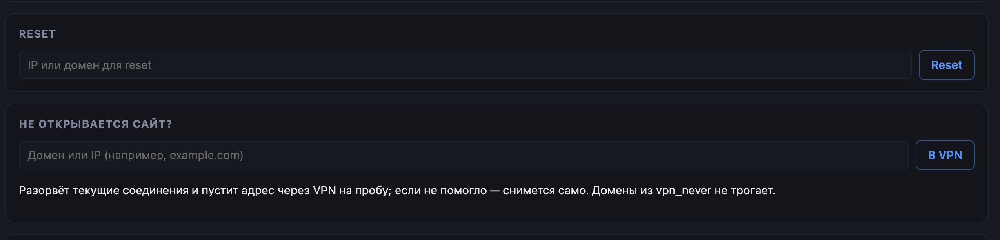
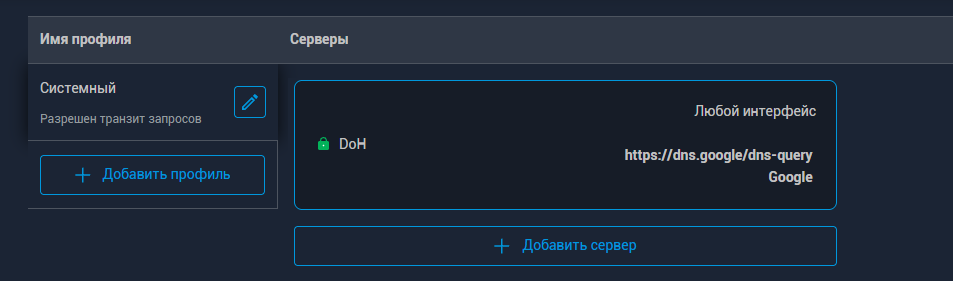

# Susanin.Keenetic

**Адаптивная VPN-маршрутизация для KeeneticOS (Entware) · Adaptive VPN routing for KeeneticOS · 面向 KeeneticOS 的自适应 VPN 路由**

[](src)
[](README.md)
[](README.md)
[](README.md)
[](LICENSE)
[](https://github.com/kryoz/susanin/releases)

Проект не связан и не аффилирован с Keenetic, Amnezia, WireGuard, MikroTik или
авторами упомянутых сторонних проектов. Используйте на свой страх и риск —
сделайте резервную копию конфигурации роутера.

## Зачем этот форк

Основное и оригинальное решение позаимствовано из [R17a/Susanin.Keenetic](https://github.com/R17a/Susanin.Keenetic). Если у вас он работает - значит вам мой форк не нужен.
Данное решение рассчитано на владельца Keenetic с Entware, у которого egress коннектор - **OpenConnect**, поддержки которого в апстриме нет.

<hr>

Адаптивная маршрутизация: программа смотрит, какие соединения «не работают» из-за
блокировок, пробует их через VPN, запоминает рабочие и дальше держит их в VPN. Если
VPN недоступен — всё идёт напрямую. Есть и простой список доменов, которые должны
идти через VPN **всегда** (без ручных списков IP — только имена, как в
Keenetic).

**Что делает**

- наблюдает за поведением соединений (conntrack), а не за содержимым;
- по «тихим» признакам блокировок (TCP SYN без ответа, QUIC/UDP без reply,
  TCP-stall, DPI-RST) проверяет адрес через VPN и запоминает результат;
- держит подтверждённые направления в VPN с конечным TTL (`ok_ttl`, 6 ч) и снимает
  их сам, если через VPN перестало отвечать;
- списки «всегда через VPN» и «всегда напрямую»: домены, wildcard `*.example.com`,
  CIDR, IP;
- fail-open (нет туннеля — прямой доступ), failover между несколькими VPN и
  автоматический возврат на приоритетный;
- egress — интерфейс (`nocli*`);
- профили маршрутизации: до 4 списков «домены/CIDR → свой туннель»;
- встроенная веб-панель (только LAN) с интерфейсом на русском, английском и
  китайском; по умолчанию выключена; кнопка «Не открывается сайт?» (жалоба, 0.5.0);
- сам восстанавливает правила, если их снёс NDM (окно без правил ≤1 с, 0.5.0), и
  умеет маршрутизировать клиентов OpenConnect-сервера на этом же роутере.

Не является VPN-клиентом: туннель («Другое подключение»: OpenConnect-коннектор) должен уже работать. IPv6 в v1 не поддерживается.

### Нововведения форка с v0.5.0-oc

#### Кнопка «Не открывается сайт?» 

Иногда попадаются ресурсы, которые отдают только первые байты по запросу, а потом коннект зависает.
Если у вас такой случай, то попробуйте данный функционал из веб-панели:



Есть и расширение для браузера (Chrome/Edge/Yandex, Manifest V3): `ext/complain-chrome` — распаковать,
`chrome://extensions` → «режим разработчика» → «Загрузить распакованное»;
контекстное меню «Susanin: в VPN» на любой странице/ссылке + попап с вводом
домена и кнопками «В always / Из always / В never / Из never» для текущего
сайта (списки панели, тот же `POST /api/list`, что у редактора панели).
Панельный адрес и токен — в попапе («Настройки панели»).

Агент разрешит домен, снимет его с `vpn_never`, поставит адреса в
тестовую фазу и разорвёт текущие коннекты клиента — браузер переподключится
уже через туннель, а судья подтвердит исход по факту трафика. Сайт в
`vpn_never` — жалоба отклоняется (сними с never и повтори). 

CLI-аналог: `/opt/susanin/bin/susanin-agent complain <домен|ip>`. 

#### domain_prior — очередь «быстрого прохода» для обучения Susanin

Как работает Susanin обычно: он постоянно подозревает часть сайтов, что «их блокируют» и проверяет их через VPN. Проверять все сразу нельзя — стоит лимит (сколько-то адресов в минуту). Новый блокируемый сайт может простоять в очереди минуту-другую, и всё это время у тебя он «не открывается».

Что даёт domain_prior: это короткий список доменов (по одному на строке, как `vpn_always.txt`). Если сайт из этого списка попался — Susanin проверяет его **первым, вне очереди**. Лимит не отменяется, правила не меняются — меняется только порядок: «проверь сначала то, что у меня уже пригревало».

Аналогия: в аэропорту все стоят в одну очередь на досмотр, а `domain_prior` — это полоса «быстрый проход» для тех, кто летает отсюда каждый день.
Или же своего рода дополнительный слой кеша между резидентным слоем проб и `vpn_always.txt`

Важно, чем он **не** является:
- это **не** «всегда в VPN» — для этого есть `vpn_always.txt`;
- он не решает «блокировать/не блокировать» — вердикт как всегда выносит судья по факту трафика через туннель; ошибка в списке стоит ровно одну лишнюю проверку, ничего не ломая;
- пустой файл = механизм просто выключен.

Это прежде всего может оказаться полезно для нагруженных роутеров и частых запросов к флапающим CDN.

Откуда берётся список: он строится **из твоей же сети** — Susanin пишет в лог, какие домены у тебя уезжали в VPN, а офлайн-скрипт (`tools/dataset.py`, одна команда на компьютере с Python) превращает суток лога в готовый `domain_prior.txt`. Кладёшь файл на роутер — он подхватывается сам, без рестарта. В поставке файл пустой и это нормально: приор — ускоритель, а не настройка, без которой не работает.

#### Построение `domain_prior.txt` на базе своих логов

Приор ускоряет повторное заворачивание доменов, которые уже блокировались в
**твоей** сети. Инструмент — `tools/dataset.py` (чистый Python 3, без
зависимостей; в пакет не входит, берётся из репозитория).

**Шаг 1. На роутере включить видимость** (на несколько дней наблюдений;
`log_level` и `dns_sniff` применяются только `restart`, не `reload`):

```sh
/opt/susanin/bin/susanin-agent config set log_level trace
/opt/susanin/bin/susanin-agent config set dns_sniff 1
sh /opt/susanin/tools/susanin.sh restart
```

**Шаг 2. Забрать логи** (нужны несколько суток; `trace` даёт ~3 МБ/сут,
ротация на роутере держит только 3×5 МиБ — затягивать нельзя; `.gz` тренер
читает сам):

```sh
scp -P 222 root@<роутер>:'/opt/susanin/var/susanin.log*' .
```

**Шаг 3. Обучить приор** (на машине с Python 3; зависимости не нужны).
Тренеру нужны строки `dns-map:` — они пишутся при включённом `dns_sniff`:

```sh
scp -P 222 root@<роутер>:/opt/susanin/etc/vpn_always.txt .
scp -P 222 root@<роутер>:/opt/susanin/etc/vpn_never.txt .
python3 tools/dataset.py susanin.log* --prior domain_prior.txt \
  --lists vpn_always.txt vpn_never.txt --eval-hours 12
```

- `--lists` вычеркивает из обучения домены твоих списков: пин-доменам приор
  не нужен (они и так всегда в VPN), never-доменам противоречит (решение
  владельца первее статистики);
- `--deny deny.txt` (по желанию) — файл исключений по одному домену на
  строку (`#` — комментарий). Сюда вычеркивают общие CDN с «коллапсальными»
  подтверждениями: IP соседа по CDN-периферии реально блокируется, проба
  честно подтверждает туннель, а домен-инфраструктура наследует вину соседа
  (типичные кандидаты: `rtbcdn.*`, ozone-подобные маркетплейсы за общим
  edge). После обучения просмотреть список глазами и довычеркнуть лишнее —
  файл правится руками, это нормальный этап;
- `--eval-hours 12` — честная оценка: приор учится на первых 12 часах,
  проверяется на остальных. В сводке: `prior_promos` — сколько промоушенов
  теста пришлось на prior-домены, `prior_conf` — сколько из них
  подтвердились (точность = conf/promos), `domain_cov` — покрытия сколько
  подтверждений вообще имеют известный домен (потолок ~20 %, клиенты с DoH
  невидимы).

**Шаг 4. Положить результат на роутер** (перечитывается по mtime, рестарт
не нужен):

```sh
scp -P 222 domain_prior.txt root@<роутер>:/opt/susanin/etc/domain_prior.txt
```

**Что ожидать.** Приор меняет только порядок очереди промоушенов: кандидат
из списка проходит **вперёд лимита** `promo_per_min`. На малоклиентской
сети эффекта незаметно (очередь не насыщается), вердикты и пороги он не
меняет никогда — проверять факт работы по строкам `prior (domain_prior)`
в логе. Вред минимален по построению: лишний домен в списке стоит одну
лишнюю пробу.

**Требования**

- Keenetic с Entware; пакеты `ipset`, `iptables`, `conntrack`,
  `ca-certificates` + `wget-ssl`;
- работающий VPN-туннель — для этого форка клиентский OpenConnect-коннектор
  (`nocliN`), также WireGuard/AmneziaWG или Xray/VLESS+REALITY;
- в Keenetic **выключена «Маршрутизация DNS»**, включён шифрованный DNS (DoH/DoT) —
  иначе возможны подмена DNS и «YouTube/Claude не открывается».

  
  

**Быстрый старт**

Установка из релизов форка:

```sh
opkg update && opkg install ca-certificates ipset iptables conntrack wget-ssl
wget -qO- https://raw.githubusercontent.com/kryoz/susanin/fix/oc-connector-egress/install.sh \
  | SUSANIN_REPO=kryoz/susanin sh -s -- --ipk --version v0.5.0-oc --yes
```

**Веб-панель (только LAN):** `web_enable=1`, `web_listen=192.168.1.1`,
`web_port=8087` в `/opt/susanin/etc/susanin.conf`, затем
`sh /opt/susanin/tools/susanin.sh web restart` → `http://192.168.1.1:8087/`.
Язык интерфейса — в шапке справа: русский (по умолчанию), английский, китайский.

**Документация**
- [USER_GUIDE.md](USER_GUIDE.md) — руководство: быстрый старт, задачи, настройки;
- [DEPLOY.md](DEPLOY.md) — установка, обновление, удаление, автозапуск;
- [TECHNICAL.RU.md](TECHNICAL.RU.md) — технические детали: как устроено, списки
  доменов, OpenConnect/qWDTT/XRay, профили, CLI, сборка, все параметры конфига;
- [TROUBLESHOOTING.md](TROUBLESHOOTING.md) — если что-то не работает, по симптомам;
- [XRAY.md](XRAY.md) — XRay/VLESS-REALITY: совместимость, конфликты, XKeen;
- [CHANGELOG.md](CHANGELOG.md) — что нового по версиям.

<hr>

## 🇬🇧 English

The project is based on the [Habr article](https://habr.com/ru/articles/1076620/) and
on [Fiark/susanin](https://github.com/Fiark/susanin) (adaptive VPN routing for
MikroTik RouterOS), ported to Keenetic/Entware routers.

Adaptive routing: the program watches which connections "do not work" because of
blocking, tries them through the VPN, remembers the working ones and keeps them in
the VPN. If the VPN is unavailable, everything goes direct. There is also a plain
list of domains that must **always** go through the VPN (no manual IP lists —
names only, like in Keenetic).

**Status: release 0.4.2.** Tested on Keenetic Viva (MT7621, MIPS),
KeeneticOS 5.1.4–5.1.5, Entware, WireGuard/AmneziaWG tunnels (`nwg0`/`nwg1`),
Xray VLESS+REALITY (`egress_type=tproxy`), Keenetic Giga/Ultra.

**What it does**

- watches connection behaviour (conntrack), not payload;
- by "silent" signs of blocking (TCP SYN with no answer, QUIC/UDP with no reply,
  TCP-stall, DPI-RST) probes the address through the VPN and remembers the result;
- keeps confirmed destinations in the VPN with a finite TTL (`ok_ttl`, 6 h) and
  removes them by itself when the route through the VPN stops answering;
- "always via VPN" and "always direct" lists: domains, `*.example.com` wildcards,
  CIDR, IP;
- fail-open (no tunnel — direct access), failover between several VPNs and
  automatic return to the preferred one;
- egress is an interface (`nwg*`, `wdtt*`) or Xray/VLESS+REALITY
  (`egress_type=tproxy`);
- routing profiles: up to 4 lists "domains/CIDR → their own tunnel";
- built-in web panel (LAN only) with a Russian, English and Chinese interface;
  disabled by default;
- repairs its own rules if NDM wipes them and can route clients of an OpenConnect
  server on the same router.

It is not a VPN client: the tunnel (WireGuard/AmneziaWG "Additional connection")
must already work. IPv6 is not supported in v1.

**Requirements**

- Keenetic with Entware; packages `ipset`, `iptables`, `conntrack`,
  `ca-certificates` + `wget-ssl`;
- a working VPN tunnel (WireGuard/AmneziaWG) or Xray/VLESS+REALITY;
- Keenetic **"DNS routing" turned off** and encrypted DNS (DoH/DoT) configured —
  otherwise DNS spoofing is possible and "YouTube/Claude does not open".

**Quick start**

```sh
opkg update && opkg install ca-certificates wget-ssl
wget -qO- https://raw.githubusercontent.com/R17a/Susanin.Keenetic/main/install.sh | sh -s -- --ipk
susanin version && susanin status && susanin diagnose
```

**Web panel (LAN only):** `web_enable=1`, `web_listen=192.168.1.1`,
`web_port=8087` in `/opt/susanin/etc/susanin.conf`, then
`sh /opt/susanin/tools/susanin.sh web restart` → `http://192.168.1.1:8087/`.
The interface language is switched in the header on the right: Russian (default),
English, Chinese.

**Documentation** (currently in Russian; translations are on the way)

- [USER_GUIDE.md](USER_GUIDE.md) — guide: quick start, tasks, settings;
- [DEPLOY.md](DEPLOY.md) — install, update, removal, autostart;
- [TECHNICAL.RU.md](TECHNICAL.RU.md) — internals, domain lists,
  OpenConnect/qWDTT/XRay, profiles, CLI, build, all config parameters;
- [TROUBLESHOOTING.md](TROUBLESHOOTING.md) — when something does not work, by symptom;
- [XRAY.md](XRAY.md) — XRay/VLESS-REALITY: compatibility, conflicts, XKeen;
- [CHANGELOG.md](CHANGELOG.md) — what changed per version.

<hr>

## 🇨🇳 中文

本项目基于 [Habr 文章](https://habr.com/ru/articles/1076620/) 和
[Fiark/susanin](https://github.com/Fiark/susanin)（面向 MikroTik RouterOS 的自适应
VPN 路由）实现，并移植到 Keenetic/Entware 路由器。

自适应路由：程序观察哪些连接因封锁而「无法工作」，尝试让它们走 VPN，记住可用的
连接并继续让它们走 VPN。如果 VPN 不可用，所有流量都直连。此外还有一份「始终走
VPN」的域名列表（无需手工维护 IP 列表——只写域名，和 Keenetic 一样）。

**状态：0.4.2 版。** 已在 Keenetic Viva（MT7621，MIPS）、KeeneticOS
5.1.4–5.1.5、Entware、WireGuard/AmneziaWG 隧道（`nwg0`/`nwg1`）、
Xray VLESS+REALITY（`egress_type=tproxy`）、Keenetic Giga/Ultra 上验证。

**功能**

- 观察连接的行为（conntrack），而不是内容；
- 依据封锁的「静默」特征（TCP SYN 无响应、QUIC/UDP 无回复、TCP-stall、DPI-RST）
  经 VPN 探测地址并记住结果；
- 以有限 TTL（`ok_ttl`，6 小时）让已确认的方向走 VPN；若经 VPN 不再响应则自行移除；
- 「始终走 VPN」与「始终直连」列表：域名、`*.example.com` 通配、CIDR、IP；
- fail-open（隧道不可用则直连）、多个 VPN 之间的故障切换与自动切回；
- egress 为接口（`nwg*`、`wdtt*`）或 Xray/VLESS+REALITY（`egress_type=tproxy`）；
- 路由配置文件：最多 4 份「域名/CIDR → 指定隧道」列表；
- 内置网页面板（仅限 LAN），界面支持俄语、英语、中文；默认关闭；
- 若 NDM 清除了规则会自动修复，还可把同一台路由器上 OpenConnect 服务器的客户端
  纳入路由。

它不是 VPN 客户端：隧道（WireGuard/AmneziaWG「额外连接」）必须已经在工作。
v1 不支持 IPv6。

**环境要求**

- 已安装 Entware 的 Keenetic；软件包 `ipset`、`iptables`、`conntrack`、
  `ca-certificates` + `wget-ssl`；
- 已工作的 VPN 隧道（WireGuard/AmneziaWG）或 Xray/VLESS+REALITY；
- Keenetic 中**关闭「DNS 路由」**并配置加密 DNS（DoH/DoT）——否则可能出现 DNS
  篡改以及「YouTube/Claude 打不开」。

**快速开始**

```sh
opkg update && opkg install ca-certificates wget-ssl
wget -qO- https://raw.githubusercontent.com/R17a/Susanin.Keenetic/main/install.sh | sh -s -- --ipk
susanin version && susanin status && susanin diagnose
```

**网页面板（仅限 LAN）：** 在 `/opt/susanin/etc/susanin.conf` 中设置
`web_enable=1`、`web_listen=192.168.1.1`、`web_port=8087`，然后执行
`sh /opt/susanin/tools/susanin.sh web restart` → `http://192.168.1.1:8087/`。
界面语言在右上角切换：俄语（默认）、英语、中文。

**文档**（目前为俄语，翻译正在准备中）

- [USER_GUIDE.md](USER_GUIDE.md) — 指南：快速开始、常见任务、设置；
- [DEPLOY.md](DEPLOY.md) — 安装、更新、卸载、开机自启；
- [TECHNICAL.RU.md](TECHNICAL.RU.md) — 技术细节：内部实现、域名列表、
  OpenConnect/qWDTT/XRay、配置文件、CLI、构建、全部配置参数；
- [TROUBLESHOOTING.md](TROUBLESHOOTING.md) — 出问题时按症状排查；
- [XRAY.md](XRAY.md) — XRay/VLESS-REALITY：兼容性、冲突、XKeen；
- [CHANGELOG.md](CHANGELOG.md) — 各版本变更。

<hr>

## Благодарности · Acknowledgements · 致谢

Спасибо людям, которые помогали проекту тестированием на своих роутерах, отчётами
с логами, разбором проблем и предложениями: **Gave_Karen**, **pegakmop**, **NJmist**.

Thanks to the people who helped the project — by testing on their routers, sending
logs, analysing problems and suggesting improvements: **Gave_Karen**, **pegakmop**,
**NJmist**.

感谢帮助过项目的朋友——在自己的路由器上测试、提交日志、分析问题并提出改进建议：
**Gave_Karen**、**pegakmop**、**NJmist**。

## Поддержать · Support · 支持

<p align="center">
  <a href="https://www.donationalerts.com/r/dmitriy_r17a"></a>
  &nbsp; &nbsp; &nbsp; &nbsp;
  <a href="https://pay.cloudtips.ru/p/dcbf5f2e"></a>
</p>

## Дисклеймер · Disclaimer · 免责声明

Проект не связан и не аффилирован с Keenetic, Amnezia, WireGuard, MikroTik или
авторами упомянутых сторонних проектов. Используйте на свой страх и риск — сделайте
резервную копию конфигурации роутера.

The project is not connected to or affiliated with Keenetic, Amnezia, WireGuard,
MikroTik or the authors of the mentioned third-party projects. Use it at your own
risk — make a backup of your router configuration.

本项目与 Keenetic、Amnezia、WireGuard、MikroTik 及上述第三方项目的作者无关，也未获
其认可。请自行承担使用风险——请备份路由器配置。

## Лицензия · License · 许可证

MIT — см. [LICENSE](LICENSE).
