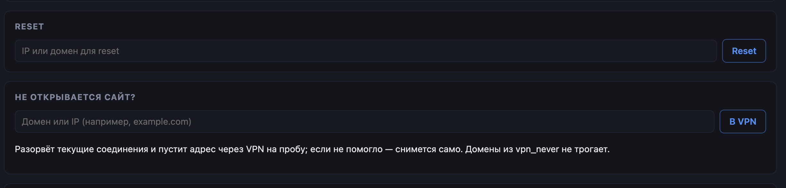
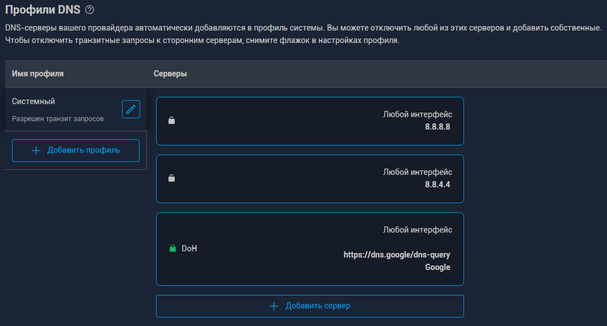

# Susanin.Keenetic

**Адаптивная VPN-маршрутизация для KeeneticOS (Entware)**

[](src)
[](DEPLOY.md)
[](DEPLOY.md)
[](DEPLOY.md)
[](https://github.com/kryoz/susanin/releases/latest)
[](LICENSE)

Оригинальное решение — [R17a/Susanin.Keenetic](https://github.com/R17a/Susanin.Keenetic),
оно же — [статья на Habr](https://habr.com/ru/articles/1076620/) и порт
[Fiark/susanin](https://github.com/Fiark/susanin) (адаптивная маршрутизация для MikroTik).
Если апстрим у вас работает — этот форк вам не нужен: он для владельца Keenetic с
Entware, у которого egress-коннектор **OpenConnect**, которого в апстриме нет.

---

## Что это

Адаптивная маршрутизация: программа смотрит, какие соединения «не работают» из-за
блокировок, пробует их через VPN, запоминает рабочие и дальше держит их в VPN. Если
VPN недоступен — всё идёт напрямую. Есть списки доменов, которые должны идти через VPN
**всегда** (без ручных списков IP — только имена, как в Keenetic).

**Статус: релиз 0.5.4.1-oc** (форк под OpenConnect-коннектор). Проверено на Keenetic
Giga KN-1012 (aarch64) и Giga/Ultra, KeeneticOS 5.1.4–5.1.6, Entware,
OpenConnect-коннектор (`nocli*`), WireGuard/AmneziaWG (`nwg0`/`nwg1`), Xray VLESS+REALITY
и VLESS+WS+TLS (`egress_type=tproxy`).

**Что делает**

- наблюдает за поведением соединений (conntrack), а не за содержимым;
- по «тихим» признакам блокировок (TCP SYN без ответа, QUIC/UDP без reply, TCP-stall,
  DPI-RST) проверяет адрес через VPN и запоминает результат;
- держит подтверждённые направления в VPN с конечным TTL (`ok_ttl`, 6 ч) и снимает их
  сам, если через VPN перестало отвечать;
- списки «всегда через VPN» и «всегда напрямую»: домены, wildcard `*.example.com`,
  CIDR, IP (`vpn_always.txt` / `vpn_never.txt`, перечитываются сами);
- fail-open (нет туннеля — прямой доступ), failover между несколькими VPN и
  автоматический возврат на приоритетный;
- egress — интерфейс OpenConnect-коннектора (`nocli*`), WireGuard/AmneziaWG (`nwg*`,
  `wg*`, `amnezia*`, `ovpn*`) или Xray/VLESS+REALITY (`egress_type=tproxy`);
- профили маршрутизации: до 4 списков «домены/CIDR → свой туннель»;
- встроенная веб-панель (только LAN), по умолчанию выключена; язык интерфейса —
  русский, английский, китайский;
- DNS-снифинг: связывает IP с доменом из DNS-ответа — списки применяются мгновенно, а
  `susanin why <ip|домен>` и лог обучения показывают, почему адрес идёт именно так;
- детект «заморозки» ТСПУ (обрыв TCP-потока после первых десятков пакетов) и
  наследование вердикта на всю /24-сеть хостинга — новые IP заблокированной сети уходят
  в VPN без проб;
- RU-guard: российские домены (`.ru`, `.рф` и др.) автообучение в VPN не заворачивает —
  антифрод банков и маркетплейсов режет чужой выход;
- UDP/QUIC через туннель (встроенный SOCKS-UDP-релей) и авто-обновление диапазонов CDN;
- сам восстанавливает правила датаплейна, если их снёс ndm (см. ниже).

Не является VPN-клиентом: туннель («Другое подключение» → OpenConnect) должен уже
работать — поднимает его Keenetic. Только IPv4.

## Чем форк отличается от апстрима

- **egress — OpenConnect-коннектор Keenetic** (`nocli*`): авто-детект, пробы туннеля с
  адреса интерфейса, `default dev nocliN` в таблице 100. До этой правки `discover` и
  `install.sh` коннектор не видели, и служба после чистой установки стартовала с `nwg0`.
- **Кнопка «Не открывается сайт?»** в веб-панели и расширение для браузера (см. ниже).
- **Восстановление датаплейна из хука ndm** (0.5.4.1-oc): пересборка firewall в ndm
  сносит цепочку `SUSANIN` — окно без метки сокращено с ~6 с до ~1 с.
- **Установка и обновления из релизов форка**: `install.sh`, `bootstrap.sh`,
  `tools/update.sh` и проверка новой версии смотрят в `kryoz/susanin`, а не в апстрим.

### Кнопка «Не открывается сайт?»

Иногда попадаются ресурсы, которые отдают только первые байты по запросу, а потом
коннект зависает. Если у вас такой случай — попробуйте этот функционал из веб-панели:



Есть и расширение для браузера (Chrome/Edge/Yandex, Manifest V3): `ext/susanin-helper` —
распаковать, `chrome://extensions` → «режим разработчика» → «Загрузить распакованное»;
контекстное меню «Susanin Helper: в VPN» на любой странице/ссылке + попап с вводом
домена и кнопками «В always / Из always / В never / Из never» для текущего сайта
(списки панели, тот же `POST /api/list`, что у редактора панели). Панельный адрес и
токен — в попапе («Настройки панели»).

Агент разрешит домен, снимет его с `vpn_never`, поставит адреса в тестовую фазу и
разорвёт текущие коннекты клиента — браузер переподключится уже через туннель, а судья
подтвердит исход по факту трафика. Сайт в `vpn_never` — жалоба отклоняется (сними с
never и повтори).

CLI-аналог: `/opt/susanin/bin/susanin-agent complain <домен|ip>`.

## Требования

- Keenetic с Entware; пакеты `ipset`, `iptables`, `conntrack`, `ca-certificates`,
  `wget-ssl`;
- работающий VPN-туннель — для этого форка клиентский OpenConnect-коннектор (`nocliN`),
  также WireGuard/AmneziaWG или Xray/VLESS+REALITY;
- в Keenetic **выключена «Маршрутизация DNS»**, включён шифрованный DNS (DoH/DoT) —
  иначе возможны подмена DNS и «YouTube/Claude не открывается»;
- у клиентов, которые учит Susanin, сняты политики «Приоритеты подключений»: у одного
  клиента должен быть один «решающий» механизм маршрутизации.




## Быстрый старт

```sh
opkg update && opkg install ca-certificates ipset iptables conntrack wget-ssl
wget -qO- https://raw.githubusercontent.com/kryoz/susanin/fix/oc-connector-egress/install.sh \
  | sh -s -- --ipk
susanin version && susanin status && susanin diagnose
```

Установщик берёт пакет из последнего релиза форка, определяет архитектуру, LAN и egress,
спрашивает подтверждение и запускает демон. Существующие `susanin.conf`,
`vpn_always.txt`, `vpn_never.txt` и кэш при обновлении не перезаписываются.

После установки обязательно сверить два поля — установщик пишет их неправильно чаще
всего (`susanin-agent config set <ключ> <значение>`, затем `susanin.sh reload`):

- `lan_subnets` = фактическая сеть LAN-моста (`ip -4 -o addr show dev br0`) — ошибка
  означает молча выключенное обучение;
- `lan_interfaces` = все LAN-мосты (`br0`, плюс `br1`, если есть).

**Веб-панель (только LAN):** `web_enable=1`, `web_listen=192.168.1.1`, `web_port=8087` в
`/opt/susanin/etc/susanin.conf`, затем `sh /opt/susanin/tools/susanin.sh web restart` →
`http://192.168.1.1:8087/`.

## Документация

- [USER_GUIDE.md](USER_GUIDE.md) — руководство: быстрый старт, задачи, настройки;
- [DEPLOY.md](DEPLOY.md) — установка, обновление, удаление, автозапуск;
- [TECHNICAL.RU.md](TECHNICAL.RU.md) — технические детали: как устроено, списки доменов,
  OpenConnect/qWDTT/XRay, профили, CLI, сборка, все параметры конфига;
- [TROUBLESHOOTING.md](TROUBLESHOOTING.md) — если что-то не работает, по симптомам;
- [XRAY.md](XRAY.md) — XRay/VLESS-REALITY: совместимость, конфликты, XKeen;
- [CHANGELOG.md](CHANGELOG.md) — что нового по версиям.

Описание релиза на GitHub собирается при публикации тега:
`.github/workflows/release.yml` берёт `.github/release-body.template.md` и вытаскивает из
`CHANGELOG.md` раздел текущей версии. Отдельных файлов `release-notes-v*.md` нет.

## Благодарности

Спасибо людям, которые помогали проекту тестированием на своих роутерах, отчётами с
логами, разбором проблем и предложениями: **Gave_Karen**, **pegakmop**, **NJmist**.

## Дисклеймер

Проект не связан и не аффилирован с Keenetic, Amnezia, WireGuard, MikroTik или авторами
упомянутых сторонних проектов. Используйте на свой страх и риск — сделайте резервную
копию конфигурации роутера.

## Лицензия

MIT — см. [LICENSE](LICENSE).
